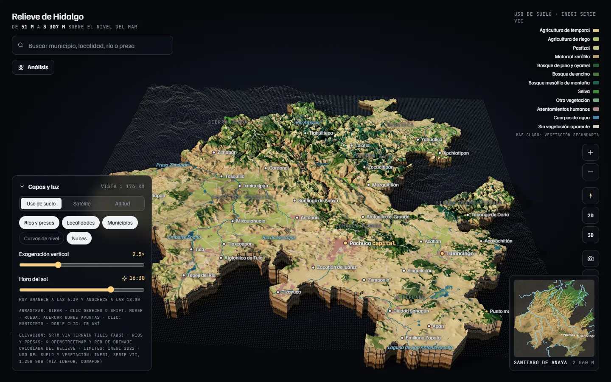
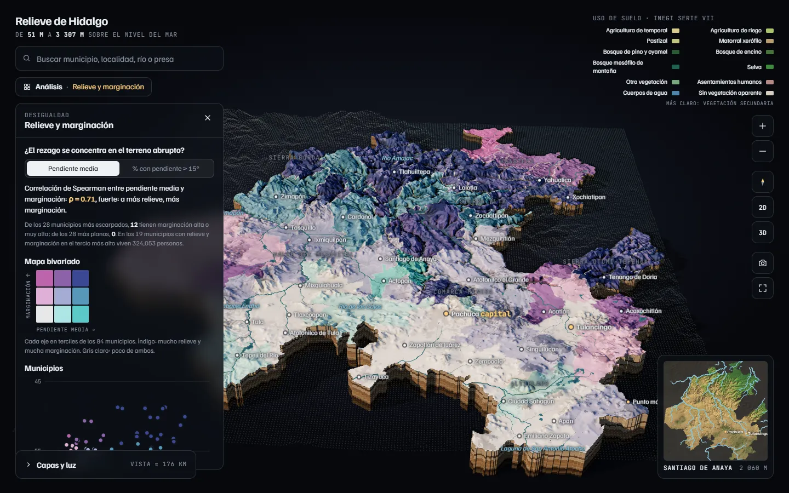
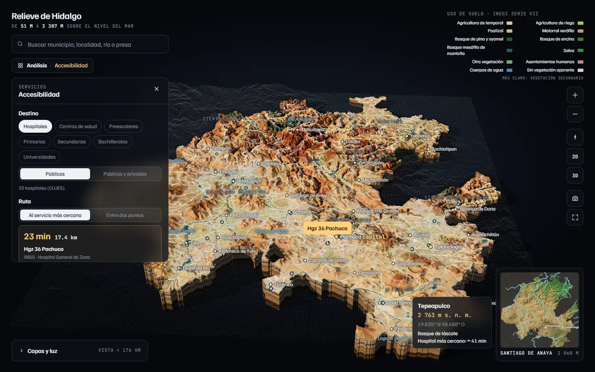
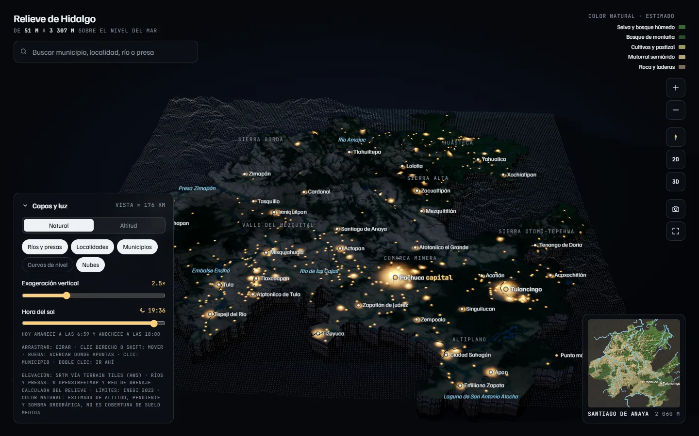

# Relieve de Hidalgo

Modelo 3D interactivo del estado de Hidalgo con datos oficiales: relieve real, uso de suelo de INEGI, imagen
satelital, ríos, presas, municipios y localidades, luz solar según la hora y vista nocturna. Además incluye análisis de
población, marginación, acceso a servicios, cuencas, inundación, laderas, cambio de uso de suelo, antenas, sol y movilidad, y herramientas
para difundirlo: recorridos guiados, geoparque, video, impresión 3D y un modo para escuelas. Está hecho con React, TypeScript y three.js y funciona como un componente
que se puede incrustar en cualquier sitio React.



## Qué se puede hacer

**Explorar el territorio**
- Relieve de INEGI con niveles de detalle: de lejos, 270 m; al acercarse, 90 m y luego 30 m (se descarga solo lo que
  está a la vista). Las cifras (pendientes, altitudes por municipio, punto más alto) se miden a 30 m.
- Tres mapas base: **uso de suelo** (INEGI Serie VII, con bordes suaves entre clases), **satélite** (Sentinel-2, sin
  las sombras de la foto; ≈ 16 m por píxel al acercarse) y **altitud**.
- Ríos calculados del relieve y guiados por OpenStreetMap, presas, límites municipales de INEGI, curvas de nivel,
  localidades del censo y regiones. Las líneas se ven nítidas a cualquier acercamiento.
- Sol en su posición real para la hora elegida; de noche se encienden las 4 690 localidades según su población.
- Nubes en 3D iluminadas por el Sol de esa hora y con su sombra sobre el relieve: cielo automático (mar de nubes al
  amanecer, cúmulos de día, tormentas con relámpagos por la tarde), cúmulos, nublado, niebla o tormenta, con cantidad,
  dirección del viento y lapso de tiempo. Se forman más donde llueve más (lluvia media anual de INEGI), su base sigue al
  relieve y de noche las ciudades iluminan su base. Se ocultan mientras hay un análisis abierto.
- **Nubes de hoy**: las que ve el satélite GOES-Este de la NOAA (imágenes de NASA GIBS, gratuitas, con ~40 min de
  retraso), en 3D sobre el relieve: la altura de cada nube sale de la temperatura de su cima y de día el visible marca
  su forma y su espesor; de noche se ven también las nubes bajas. La hora del Sol elige la imagen del día y
  «Repetir el día» anima desde las 5:00 con el Sol de cada hora; el panel dice la hora de la imagen y hacia dónde
  avanzan las nubes. También cualquier día de los últimos 90 (lo que guarda NASA), con el Sol de ese día.
- Buscador con los 84 municipios, las 5 297 localidades de INEGI (las 4 690 del censo y las deshabitadas o de una o
  dos viviendas del catálogo de localidades), ~2 800 colonias, fraccionamientos y barrios, ríos y presas. De cerca se
  etiquetan todas las localidades del censo y, más de cerca, las colonias de las ciudades.
- Ficha por municipio (población, superficie, altitudes), minimapa, imagen descargable con créditos y pantalla
  completa.
- Interfaz pensada primero para monitores grandes, luego para laptops y al final para celulares: el buscador al centro
  arriba (tecla `/`); a la izquierda, el análisis abierto ocupa toda la altura libre y «Capas y luz» queda abajo (al
  contraerse, el análisis crece); a la derecha, la leyenda del mapa base y los controles del mapa (acercar, norte, 2D o 3D,
  vista inicial y el minimapa, que empieza contraído); abajo, el municipio y la altitud del centro de la vista. En el
  celular los paneles son hojas sobre una barra de pestañas («Análisis» y «Capas y luz»).
- **Enlaces a vistas**: el botón de enlace copia una dirección que abre la misma vista (ángulo de cámara, mapa base,
  hora, exageración, nubes, municipio y el análisis abierto con lo que se eligió en él, por ejemplo el punto de una
  cuenca o el nivel de una inundación). En celular abre el menú de compartir.

**Análisis** (botón «Análisis»)

| Análisis | Qué muestra |
|---|---|
| Población | Habitantes y densidad por municipio, y cada localidad como columna 3D proporcional a su población |
| Localidades | Las 4 690 localidades del censo: filtros por tamaño, marginación y las más aisladas |
| Relieve y marginación | Si la marginación se concentra en el terreno abrupto: mapa bivariado, dispersión y correlación |
| Accesibilidad | Carreteras y tiempo de traslado al hospital, centro de salud o escuela más cercano; rutas al hacer clic |
| Cuencas | Clic en un punto: toda el área cuya lluvia escurre hasta ahí, su cauce principal, por dónde sigue el agua río abajo, y la ficha con área, desnivel, pendiente, población, municipios y ríos |
| Simulador de inundación | Sube el nivel de un río (altura sobre su cauce) o de un valle (relleno hasta un nivel) y muestra la profundidad, el área, las localidades, los hospitales, escuelas y carreteras bajo el agua. Ilustrativo, no pronóstico |
| Laderas inestables | Susceptibilidad a deslizamientos por pendiente (30 m), lluvia intensa, tipo de roca y cobertura vegetal, con el desglose de puntos de cada lugar, localidades y carreteras expuestas, comparación con el atlas estatal del CENAPRED y validación con los deslizamientos registrados |
| Cambio de uso de suelo | Series VI (2014) y VII (2018) de INEGI: pérdida de bosque, urbanización, degradación y recuperación, con matriz de cambio por municipio y cortina para comparar |
| Perfil de elevación | Corte del terreno entre dos o más puntos, en línea recta o por carretera: gráfica distancia–altura con la pendiente por tramos, subida y bajada acumuladas, punto más alto, municipios que cruza y tiempo por carretera; exporta CSV y PNG |
| Potencial solar | Radiación del Sol que recibe cada ladera al año (o comparada con un terreno plano), según el clima, la pendiente, la orientación y lo que tapan los cerros; los meses de cualquier punto, el sol que le quita el horizonte y lo que daría un panel solar ahí; cifras por municipio |
| Movilidad | Arcos 3D de quienes viajan a diario a trabajar o estudiar a otro municipio, al valle de México u otros estados (muestra del Censo 2020): adónde va la gente de cada municipio, de dónde llega, cuánto tarda y en qué |
| Cobertura de antenas | Hasta seis torres en los cerros: zona con línea de vista desde la antena (o las zonas de sombra), localidades y habitantes con y sin ella, cuánto más alta tendría que ser la antena para llegar a las que faltan, y el perfil de la línea de vista a cualquier localidad |

**Difusión** (en el mismo menú)

| Herramienta | Qué hace |
|---|---|
| Recorridos guiados | Vuelos narrados por el estado: «Hidalgo de un vistazo» (de la Huasteca a la Comarca Minera, 12 paradas), «El camino del agua» y «Geoparque Comarca Minera». Cada parada cambia la luz, el mapa base y las nubes; se puede pausar, saltar de parada o leer en voz alta. Con `?kiosco` se repiten solos para un módulo táctil en ferias |
| Geoparque y Pueblos Mágicos | Los 31 geositios del Geoparque Mundial de la UNESCO Comarca Minera y los 9 Pueblos Mágicos, con foto (Wikimedia Commons, con su autor y licencia), historia breve y vuelo a cada uno |
| Video e imagen grande | Graba en MP4 una vuelta, un acercamiento, un vuelo de una vista a otra o un recorrido completo con sus textos, en horizontal, vertical o cuadrado, cuadro por cuadro (sin tirones aunque el equipo sea lento); también la vista en 4K u 8K con nombres y créditos |
| Impresión 3D | Modelo STL (malla cerrada con base plana) del estado, un municipio o un rectángulo, con tamaño, exageración y base; para mapas táctiles, ríos hundidos o en relieve, límites y localidades en relieve |
| Hidalgo para escuelas | Las 10 regiones geoculturales, las provincias y formas del relieve, los climas, el camino de una gota de lluvia y preguntas para clase. Con `?escuelas` el visor abre en este modo, con el menú reducido y letra más grande |

Falta, de la lista original de ideas, las preguntas en lenguaje natural. Las piezas para nuevos análisis están en la base: capas
raster con su propia cobertura y paleta, cortina para comparar, consultas de elevación, pendiente, cuencas y camino
del agua, cámara guiada y grabación cuadro por cuadro (ver «Agregar un análisis»).




## Usarlo

Requiere Node 22 y pnpm 12 (el proyecto no se deja instalar con npm).

```bash
pnpm install
pnpm dev
```

Se usa pnpm por sus defensas contra paquetes secuestrados en el registro de npm (ataques que afectan a cualquier
gestor): no corre scripts de instalación de las dependencias sin permiso, no acepta versiones publicadas hace menos de
un día y rechaza las que llegan con menos garantías que las anteriores, huella típica de una cuenta robada. La
configuración y sus excepciones revisadas están en `pnpm-workspace.yaml`; `pnpm audit` revisa vulnerabilidades conocidas.

La dirección de la página sigue a la vista, así que se puede copiar de la barra del navegador o con el botón de enlace.
Parámetros: `?vista=lon,lat,km,inclinación,rumbo` (cámara; km = distancia al punto que mira), `?analisis=accesibilidad`
(o `poblacion`, `localidades`, `marginacion`, `cuencas`, `inundacion`, `laderas`, `cambio-uso`, `perfil`, `antenas`, `solar`,
`movilidad`, `recorridos`, `geoparque`, `video`, `impresion`, `escuelas`) con sus
parámetros `a.*` (por ejemplo `&a.punto=-98.7654,21.2387` en cuencas), `?mapa=satelite` o `?mapa=altitud`, `?hora=19.5`,
`?exag=3`, `?mun=13048`, `?nubes=tormenta` (o `auto`, `cumulos`, `nublado`, `niebla`, `hoy` para las del satélite —con `&dia=2026-09-11`, las de otro día—, `no`), `?lapso` (nubes en
movimiento), `?quieto` (sin giro), `?embed` (el mapa dentro de una página normal), `?kiosco` (recorridos en bucle para una
pantalla táctil: sin buscador, menú ni paneles; si alguien toma el mapa, el recorrido sigue a los 45 s) y `?escuelas`
(interfaz para clase).

Los datos procesados ya vienen en `src/relieve/data/`, así que no hace falta descargar nada para correrlo.

## Integrarlo en otro proyecto React + TypeScript

1. Copia `src/relieve/`.
2. Instala, con el gestor de ese proyecto, `three`, `@types/three`, `@fontsource/familjen-grotesk` y
   `@fontsource/jetbrains-mono`.
3. Ponlo dentro de un contenedor con altura:

```tsx
import { RelieveHidalgo } from './relieve';

<div style={{ height: 640 }}>
  <RelieveHidalgo
    cooperativeGestures                       // la rueda solo acerca con Ctrl, para no robar el scroll
    initialAnalysis="accesibilidad"
    municipioColors={{ '13048': '#f6b04a' }}  // tus propios indicadores por clave INEGI
    onSelectMunicipio={m => console.log(m?.code, m?.name)}
  />
</div>
```

El cielo inicial se elige con `initialClouds={{ kind: 'niebla', amount: 0.7, wind: 0, play: true }}` y se apaga con
`initialLayers={{ clouds: false }}`. Con `kind: 'hoy'` abre con las nubes del satélite (`day: '2026-09-11'` muestra
otro día de los últimos 90; en el panel, el selector de día). Las imágenes las pide el navegador de cada visitante a
NASA solo cuando elige «Del satélite»; `liveCloudsUrl="/api/gibs"` las pide a un proxy propio (con las mismas rutas `/wms/…` y `/wmts/…` de GIBS) y
`liveCloudsUrl={null}` quita la opción.

Para los enlaces a vistas, el componente no toca el historial del navegador: el anfitrión decide. Con la URL de la
página:

```tsx
import { RelieveHidalgo, decodeViewState, viewStateUrl } from './relieve';

<RelieveHidalgo
  initialView={decodeViewState(location.search)}       // abre la vista que trae el enlace
  onViewChange={s => history.replaceState(history.state, '', viewStateUrl(location.href, s))}
/>
```

El modo se elige con `mode="kiosco"` o `mode="escuelas"` (por omisión `"normal"`).

`viewStateUrl` conserva los parámetros propios de la página y reemplaza solo los del mapa. El botón «Copiar enlace»
usa la página actual; con `shareUrl={s => ...}` se arma otra dirección, y `showShare={false}` lo oculta. La ref
también da `getViewState()`.

Los estilos están aislados con el prefijo `rh-`, así que conviven con Bootstrap y Tailwind. three.js y los análisis
se descargan solo cuando el mapa aparece. Si los datos se sirven desde otra carpeta (por ejemplo, el `public/` de
Laravel), usa `dataBaseUrl` y copia ahí el contenido de `src/relieve/data/`.

El detalle al acercarse (`relieve-30m.bin`, `capas/satelite-16m.bin`) son paquetes de teselas que el mapa lee por
partes con peticiones *Range*, como cualquier servidor estático (Apache, nginx, un CDN). Si el servidor no las acepta,
el paquete se descarga completo una vez y todo sigue funcionando.

### Agregar un análisis

1. Crea `src/relieve/analyses/<id>/<Nombre>.tsx`, un componente que recibe `{ ctx }`.
2. Dibuja con `ctx.map`: colores por municipio, capas raster (`addRaster`: tu propia cobertura, resolución y paleta,
   con `valueAt` para consultar el valor), puntos, columnas, líneas, arcos 3D de origen a destino (`addArcs`), cortina para
   comparar (`compare`), clics y ficha del cursor. Todo lo que crea se borra solo al cerrar el análisis, así no afecta a los demás.
3. Si necesitas el relieve, pídelo a `ctx.data.terrain()`: elevación de puntos, perfiles, rejillas de elevación,
   pendiente, orientación o área drenada, cuenca de un punto, camino del agua, inundación y zona visible desde torres
   (30 m donde hay teselas, si no 90 m).
4. Para presentar: `ctx.map.followPath(ms => vista)` guía la cámara cuadro por cuadro, `prefetch(vista)` baja antes el
   detalle de donde va a ir, `capture({ width, height })` graba cuadro por cuadro a tamaño fijo (video, fotos grandes) y
   `ctx.scene.set({ baseMap, hour, clouds… })` cambia lo del panel «Capas y luz» (vuelve solo al cerrar el análisis).
5. Regístralo en `src/relieve/analyses/registry.ts`.
6. Para que lo que elige el usuario viaje en los enlaces, usa `useLinked` en lugar de `useState`:
   `const [vista, setVista] = useLinked(ctx.link, 'vista', 'indice', oneOf('indice', 'atlas'))`.

```tsx
const cuenca = await ctx.data.terrain().watershed(lon, lat);
ctx.map.addRaster({ kind: 'categorical', ...cuenca.grid, palette: [null, '#4fc3f7'], opacity: 0.5 });
```

## Datos

```bash
pnpm data:fetch   # descarga las fuentes oficiales a data-src/cache (relieve, OSM, INEGI, CONAPO, CLUES…)
pnpm data         # las procesa y genera src/relieve/data
pnpm data:db      # las carga en PostgreSQL (configura .env a partir de .env.example)
```

Todo se regenera desde las fuentes públicas, incluido el relieve: el primer paso arma un relieve de ~30 m con las
teselas de elevación y de ahí saca el relieve del visor (270 m), el de 90 m, las teselas de 30 m, la red de ríos, las
direcciones de flujo y las estadísticas por municipio y localidad. Si Overpass no responde, los ríos y presas salen de
la copia `data-src/osm_agua.json.gz`.

Los datos procesados pesan ~42 MB, pero al abrir el mapa se descargan ~4 MB (cada análisis baja sus capas al abrirse); el resto (relieve de 30 m e imagen fina)
llega por partes al acercarse.

### Pruebas

```bash
pnpm test               # pruebas unitarias (Node, sin dependencias extra)
pnpm visual --update    # guarda vistas de referencia del visor en shots/visual-base/
pnpm visual             # las vuelve a capturar y marca en rojo lo que cambió (shots/visual-diff/)
```

Las referencias visuales dependen de la tarjeta gráfica: se comparan en el mismo equipo.

La base de datos (esquema `relieve`) tiene municipios, localidades con minutos al servicio más cercano, servicios,
lugares (localidades fuera del censo y colonias), uso de suelo (Series VII y VI), la red de ríos con orden de Strahler, deslizamientos registrados,
susceptibilidad de laderas y radiación solar por municipio, traslados al trabajo y a la escuela entre municipios, geositios y Pueblos Mágicos, la región geocultural de cada municipio, la red vial como grafo y vistas para consultas frecuentes. El mapa
no la necesita: lee archivos estáticos comprimidos. La base es para consultas, análisis y la API del laboratorio.

### Fuentes y licencias

| Dato | Fuente | Licencia |
|---|---|---|
| Elevación | INEGI, Continental relief 2016, y USGS (SRTM, GMTED2010), vía Terrain Tiles (AWS Open Data) | Términos de libre uso del INEGI; USGS: dominio público |
| Límites municipales | INEGI, Marco Geoestadístico 2022 | Términos de libre uso del INEGI |
| Uso del suelo y vegetación | INEGI, Series VII y VI 1:250 000 (vía IDEFOR, CONAFOR) | Términos de libre uso del INEGI |
| Nubes de hoy | NOAA, satélite GOES-Este (bandas 2 y 13, GeoColor de CIRA), vía NASA GIBS (ESDIS) | Datos de la NOAA y la NASA sin restricciones de uso (citar GIBS) |
| Lluvia media anual (nubes; en laderas solo para comparar) | INEGI, precipitación media anual 1910–2009 (vía IDEFOR, CONAFOR) | Términos de libre uso del INEGI |
| Lluvia intensa (laderas) | Climate Hazards Center (UCSB), CHIRPS v3.0, lluvia por pentadas a 0.05° | Dominio público (citar doi:10.15780/G2JQ0P) |
| Tipo de roca (laderas) | INEGI, geología 1:250 000 serie I (vía IDEFOR, CONAFOR) | Términos de libre uso del INEGI |
| Deslizamientos y zonas de peligro | CENAPRED, Atlas Nacional de Riesgos: atlas estatal de Hidalgo | Información pública del Gobierno de México |
| Deslizamientos registrados | NASA, Global Landslide Catalog | Datos abiertos de la NASA |
| Radiación solar (nivel del año) | Global Solar Atlas 2.0 (Banco Mundial, ESMAP; datos © 2019 Solargis), global y difusa 1999–2018 | CC BY 4.0 (con la cláusula de mediación de Solargis) |
| Radiación solar (reparto en los meses) | NASA, proyecto POWER (CERES SYN1deg), climatología 2001–2025 | Datos abiertos de la NASA (citar a POWER) |
| Traslados al trabajo y a la escuela | INEGI, Censo de Población y Vivienda 2020, microdatos de la muestra (cuestionario ampliado) | Términos de libre uso del INEGI |
| Población, localidades y luces nocturnas | INEGI, Censo de Población y Vivienda 2020 (ITER) | Términos de libre uso del INEGI |
| Localidades que el censo agrupa o no tienen habitantes | INEGI, Catálogo Único de Claves de Áreas Geoestadísticas (servicio web) | Términos de libre uso del INEGI |
| Colonias, fraccionamientos y barrios (buscador) | INEGI, DENUE: asentamiento de cada dirección, en la mediana de sus negocios | Términos de libre uso del INEGI |
| Marginación | CONAPO, índices de marginación 2020 por municipio y localidad | Datos abiertos del Gobierno de México |
| Unidades médicas | Secretaría de Salud, catálogo CLUES (agosto 2026) | Datos abiertos del Gobierno de México |
| Escuelas | INEGI, DENUE | Términos de libre uso del INEGI |
| Carreteras, ríos, presas | © colaboradores de OpenStreetMap | ODbL 1.0 |
| Geositios del Geoparque Comarca Minera | Canet, C. et al. (2017), Terra Digitalis 1(2), UNAM: tabla de los 31 geositios con coordenadas | Se usan los datos (nombres, interés y ubicación), citando el artículo |
| Fotos de los geositios y Pueblos Mágicos | Wikimedia Commons (autor y licencia en cada ficha: CC BY, CC BY-SA o CC0) | La de cada foto |
| Regiones geoculturales | Secretaría de Cultura del Estado de Hidalgo, mapa de regiones geoculturales (2019) | Información pública del Gobierno del Estado |
| Climas, provincias fisiográficas y topoformas | INEGI, 1:1 000 000 (vía IDEFOR, CONAFOR) | Términos de libre uso del INEGI |
| Imagen satelital (todo el estado y teselas finas) | Sentinel-2 cloudless 2016, EOX IT Services GmbH (datos modificados de Copernicus Sentinel 2016) | CC BY 4.0 |

Estas atribuciones aparecen en el mapa y en la imagen descargable, y deben conservarse.

### Ten en cuenta
- Los **tiempos de traslado** son estimados sin tráfico: dependen del tipo de vía, el pavimento, la pendiente y las
  curvas. Úsalos para comparar zonas, no como el tiempo exacto de un viaje.
- El **DENUE** registra sobre todo escuelas urbanas. En zonas rurales faltan planteles, así que los tiempos a
  escuelas salen mayores a los reales.
- Las **colonias** salen de las direcciones de los negocios del DENUE: una colonia sin negocios registrados no aparece
  en el buscador, y su punto es el centro de sus negocios, no el de su polígono.
- En el índice de **marginación** de CONAPO 2020, un valor menor significa mayor marginación. Los análisis lo
  invierten para que «más» se lea como «más marginación».
- Las **pendientes** dependen de la resolución: medidas a 30 m son mucho mayores que a 270 m (en el estado, 40 % del
  territorio supera 15° a 30 m contra 23 % a 270 m). Las cifras del visor y de la base usan 30 m.
- Los **ríos** son la red de drenaje calculada del relieve a 90 m (guiada por los ríos de OpenStreetMap), no la red
  hidrográfica oficial de INEGI: sirven para ver por dónde corre el agua, no para deslindar cauces.
- Las **cuencas** se calculan dentro del rectángulo que cubre el mapa (Hidalgo y un margen de los estados vecinos): lo
  que drena desde más lejos (por ejemplo, el río Tula desde el valle de México) no se cuenta, ni el agua que el valle
  de México manda al río Tula por sus drenajes. El análisis lo avisa. La cuenca del Amajac antes de unirse al Moctezuma da 6 991 km², contra
  6 954 km² publicados para su subcuenca.
- La **inundación** es ilustrativa: llena el terreno hasta un nivel (o a cierta altura sobre el cauce) sin caudal, lluvia,
  tiempo, bordos ni drenaje, y el relieve de 30 m tiene errores de metros en lo plano. No es un pronóstico.
- **Laderas** es un índice propio de susceptibilidad (pendiente, lluvia intensa, roca y cobertura): dice dónde el terreno
  es más propenso a deslizarse, no cuándo. El Mapa Nacional de Susceptibilidad del CENAPRED aún no se publica para
  Hidalgo; el análisis se compara con las zonas de peligro del atlas estatal y con 216 deslizamientos registrados en
  2008 y 2009: el 54 % cayó en las laderas de susceptibilidad alta o muy alta, que ocupan el 20 % del estado. Esos
  registros están junto a caminos y poblados, donde alguien los reportó.
- El **cambio de uso de suelo** compara series 1:250 000: los cambios pequeños no se ven y parte de las diferencias son
  de interpretación entre series.
- En las planicies, el relieve de INEGI trae un rayado; al acercarse, el sombreado de 30 m se usa solo en laderas.
- El **perfil** usa el relieve de 30 m: en puentes, túneles y cortes no ve la obra (el perfil baja a la barranca o sube
  a la loma), y por carretera la pendiente de 100 m en 100 m puede salir mayor que la de la vía, que va cortada en la
  ladera. La subida acumulada ignora vaivenes de menos de 3 m para no contar el ruido del relieve.
- La **cobertura de antenas** es línea de vista sobre el relieve de 30 m (con la curvatura de la Tierra y la refracción
  normal), no un modelo de propagación: no toma en cuenta la frecuencia, la potencia, la zona de Fresnel, los árboles
  ni los edificios. Sirve para ver qué tapa el relieve, no para prometer señal.
- La **movilidad** sale de la muestra del censo (estimaciones con factor de expansión): los flujos con menos de 20 registros son
  imprecisos y se ocultan si no se piden. Solo cuenta a quienes viven en Hidalgo (no a quien viene de otro estado a trabajar aquí);
  la Ciudad de México va como un solo lugar porque la mitad no dijo la alcaldía.
- El **potencial solar** es el promedio de muchos años sobre el relieve de 90 m: no ve árboles ni edificios, y un año nublado da
  menos. El clima viene del Global Solar Atlas suavizado a ~5 km; en lo plano coincide con el Atlas a ±1 % y un panel a la inclinación
  óptima sale 1–2.5 % abajo de lo que da el Atlas. Lo que daría un panel es una estimación sencilla (rendimiento de 80 %).
- Los **recorridos** y el **modo escuelas** son textos de divulgación hechos con datos de INEGI, de la Secretaría de Cultura y del
  artículo del geoparque; los de escuelas están pendientes de revisión por docentes. Las regiones geoculturales cambian según la fuente:
  se sigue el mapa de la Secretaría de Cultura, que pone a Pachuca en la Cuenca de México y a Pisaflores en la Huasteca.
- El **video** cuadro por cuadro necesita un navegador con WebCodecs y H.264 (Chrome, Edge o Safari recientes); en otros se graba
  en tiempo real y puede salir con tirones. Grabar tarda más que lo que dura el video (un recorrido de 2 min, ~10 min en un equipo
  de oficina con tarjeta integrada).
- La **impresión 3D** sigue el relieve de 30 o 90 m: no hay más detalle que ese aunque se pida «Fino». Un estado de 20 cm sale de
  ~25 MB; los rectángulos finos pueden pasar de 100 MB. Las marcas táctiles se aprecian desde ~0.8 mm de alto.
- Las **nubes** simuladas sirven para ver el relieve con distintos cielos, no son un pronóstico: se reparten según la
  lluvia media anual y la hora, no según el tiempo de hoy.
- Las **nubes de hoy** están donde el satélite las ve, pero su forma en 3D es una reconstrucción: la altura de la cima
  sale de su temperatura (con un error de ~1 km; los cirros delgados salen más bajos), la base se supone y el detalle
  fino es ruido. Las imágenes llegan con ~40 minutos de retraso.



## Estructura

```
src/relieve/           componente integrable
  engine/              motor 3D (three.js): relieve con niveles de detalle, teselas, capas raster, rutas, mapas base
  analyses/            análisis y su registro
  shared/              lógica compartida por el navegador y los scripts de datos (rutas, cuencas, pendientes)
  worker/              arranque del relieve, worker de relieve (relieve fino, teselas y consultas de los análisis), clima de las nubes e imágenes de GOES
  data/                datos procesados que carga el mapa
scripts/pipeline/      descarga y procesamiento de fuentes (relieve, hidrología, población…), carga a PostgreSQL
scripts/               capturas (pnpm shot), regresión visual (pnpm visual) y rendimiento (pnpm perf)
tests/                 pruebas unitarias (pnpm test)
data-src/              copia de respaldo de ríos y presas (OSM); cache/ y out/ se generan
```
